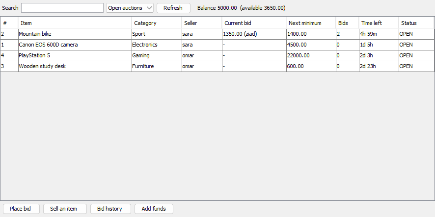

# Online Auction System (Java Swing)

> University coursework, The British University in Egypt, 2023. Author: Ziad Ayman.

A desktop auction marketplace: users register, list items with a starting price and an end time, bid against each other, and the system automatically settles each auction, moving money from the winner to the seller. All business rules live in a plain-Java domain layer with a full test suite; the Swing interface only calls into it.



## Features
- **Accounts:** registration and login, with passwords stored as salted **PBKDF2-HMAC-SHA256** hashes (120,000 iterations) and compared in constant time. Login errors never reveal whether a username exists.
- **Listings:** title, category, condition, starting price, minimum increment and duration; search by title or category; open or all auctions; live "time left".
- **Bidding rules:**
  - a bid must reach the starting price, or the current bid plus the increment;
  - sellers cannot bid on their own items, and nobody can bid after the end time;
  - the leading bid is **held** from the bidder's balance, released automatically when they are outbid, and raising your own bid only needs the difference.
- **Settlement:** when an auction ends, the winner's hold becomes a payment to the seller (sold), or the item is marked unsold. Tests confirm no money is ever created or destroyed.
- **Persistence:** everything is saved to a single file after each action, written to a temporary file and atomically moved into place, and loaded through an allow-list deserialisation filter.
- **Exact money:** whole cents in a `long`, parsed with `BigDecimal`.

## Design
```
model/    User, Auction, Bid, AuctionHouse (all business rules), Passwords, Money
service/  Storage (atomic save, filtered load)
ui/       AuctionApp (login, auction table, bid / sell / history / add funds)
```
`AuctionHouse` takes a `Clock`, so tests can move time forward to close auctions deterministically.

## Tests (33 checks, no external libraries)
```bash
./build.sh        # or build.bat on Windows
```
Password hashing (salted, never plain text), registration and login rules, every bidding rule, holds and releases, settlement and conservation of money, search and validation, and save/load round-trips.

## Run it
```bash
./build.sh
java -cp out com.ziad.auction.ui.AuctionApp            # data saved to auction-data.bin
```

## About this version
The original 2023 coursework had the login and product screens but no auction logic: no bids, winners or payments, with empty payment and shipping classes and plain-text passwords. This version keeps the idea and screens and builds the complete auction workflow, security, persistence and tests.

## Tech stack
Java 17 · Swing · java.time · PBKDF2 (javax.crypto) · Java serialisation with input filters
